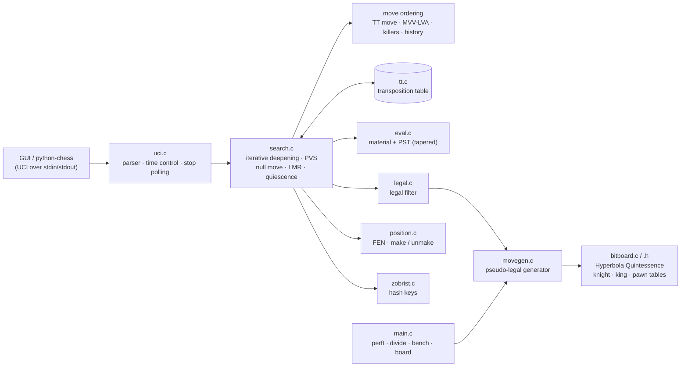

```text
   ____       ____  _ _   ____                      _
  / ___|     | __ )(_) |_| __ )  ___   __ _ _ __ __| |
 | |   _____ |  _ \| | __|  _ \ / _ \ / _` | '__/ _` |
 | |__|_____|| |_) | | |_| |_) | (_) | (_| | | | (_| |
  \____|     |____/|_|\__|____/ \___/ \__,_|_|  \__,_|
        a bitboard chess engine in C11  ·  UCI  ·  0 dependencies
```

[](https://github.com/DakodaStemen/C-BitBoard/actions/workflows/ci.yml)
[](https://en.wikipedia.org/wiki/C11_(C_standard_revision))
[](LICENSE)

A from-scratch chess engine: 64-bit bitboards, Hyperbola Quintessence slider attacks,
a perft-verified move generator, and an alpha-beta search that speaks UCI, so it plugs
straight into Arena, Cute Chess, Lichess-bot, python-chess, etc.

## Quick start

```sh
make                       # gcc/clang, C11, no dependencies
./cbitboard                # UCI mode (what GUIs launch)
./cbitboard 6              # perft(6) from the start position -> 119,060,324
./cbitboard bench          # deterministic search benchmark (default depth 9)
./cbitboard hashcheck 5    # asserts incremental Zobrist == full recompute at every perft node
make test                  # perft suite + bench signature + UCI tests (needs `pip install chess`)
```

Add `./cbitboard` as a UCI engine in any GUI. Options: `Hash` (MB, default 64), `Clear Hash`, `Move Overhead`.

## Architecture



| File | Role |
|---|---|
| `bitboard.[ch]` | Attack tables; HQ for diagonals/files, 8-bit LUT for ranks |
| `movegen.c` | Pseudo-legal generation, castling, en passant, promotions |
| `position.c` | FEN parsing, `do_move` / `undo_move` |
| `legal.c` | Legal filter (make → test king safety → unmake) |
| `eval.c` | Material + piece-square tables, middlegame/endgame king tapering |
| `search.c` | Negamax PVS, iterative deepening, quiescence, pruning, ordering |
| `tt.c`, `zobrist.c` | Hash table and Zobrist keys (key is updated incrementally in `do_move`/`undo_move`) |
| `uci.c` | UCI protocol, time management, `bench` |

## Engine features

- **Search:** iterative deepening, principal-variation search, quiescence (captures + promotions), check extensions, null-move pruning, reverse futility pruning, aspiration windows, late-move reductions, mate-distance pruning, 50-move and repetition draws.
- **Ordering:** TT move → MVV-LVA captures → promotions → killers → history heuristic.
- **Transposition table:** Zobrist-keyed, depth/bound entries, mate-score ply adjustment, `Hash` UCI option.
- **Evaluation:** material + piece-square tables (Michniewski's "simplified evaluation") with a tapered king table. Deliberately simple.
- **UCI:** `position`, `go` (depth / nodes / movetime / wtime·btime·inc·movestogo / infinite), `stop` honored mid-search, `go perft N`.

> [!TIP]
> `go perft N` over UCI uses the *legal* generator, handy for cross-checking against other tools.

## Results

All numbers below were measured on the machine described in [Methodology](#methodology); none are copied from elsewhere.

### Correctness: perft

Every row passes against the published reference counts ([Chess Programming Wiki](https://www.chessprogramming.org/Perft_Results)).
Full tier (deeper plies, 12 rows) was run locally in 61 s wall; CI runs the `quick` tier.

| Position | Depth | Nodes | Result |
|---|---|---|---|
| Start position | 6 | 119,060,324 | ✅ |
| Kiwipete | 5 | 193,690,690 | ✅ |
| CPW position 3 | 6 | 11,030,083 | ✅ |
| CPW position 4 | 5 | 15,833,292 | ✅ |
| CPW position 5 | 5 | 89,941,194 | ✅ |
| CPW position 6 | 5 | 164,075,551 | ✅ |

Plus: `go perft 3` through UCI matches python-chess on 54 random-game positions (0 mismatches), and ASan/UBSan runs are clean in CI.

### Speed

Produced by [`tools/bench_table.py`](tools/bench_table.py) (best of 9 runs per row).

| Position | Depth | Nodes | Mnodes/s |
|---|---|---|---|
| startpos | 5 | 4,865,609 | 15.4 |
| kiwipete | 4 | 4,085,603 | 17.3 |
| position3 | 5 | 674,624 | 16.4 |
| position4 | 4 | 422,333 | 14.0 |
| position5 | 4 | 2,103,487 | 20.8 |
| position6 | 4 | 3,894,594 | 20.0 |

#### Incremental Zobrist hash

Before (`60fcb1e`, hash recomputed from scratch every node) vs after (`615c936`, key updated in `do_move`/`undo_move`).
`./cbitboard bench 8`, identical node count in both builds (1,018,005), 7 interleaved runs each, speed measured as nodes per
**CPU-second** (`getrusage`) so host load does not inflate it.

| Build | Nodes | knps (best of 7) | knps (median of 7) |
|---|---|---|---|
| before | 1,018,005 | 2,117 | 2,097 |
| after | 1,018,005 | 2,433 | 2,339 |

Best-of-7: +14.9 %; median-of-7: +11.5 %. `./cbitboard hashcheck 5` verifies incremental == recomputed key at all 4,865,609 perft(5) nodes (0 mismatches).

#### Slider attacks: Hyperbola Quintessence vs magic bitboards

[`tools/slider_bench.c`](tools/slider_bench.c) (`make slider-bench`) searches magics at startup, cross-checks every lookup against HQ
(400,000 lookups, 0 mismatches) and times both. Table: minimum of 8 whole-program runs, ns/call (best of 15 inside each run).

| Lookup | HQ (this engine) | Magic | Table memory |
|---|---|---|---|
| Rook | 2.48 | 2.11 | HQ 2 KiB rank LUT vs magic 800 KiB |
| Bishop | 2.69 | 1.44 | HQ none vs magic 41 KiB |
| Queen | 5.40 | 3.69 | (rook + bishop) |

> [!WARNING]
> The host was at load average ≈ 60 on 16 threads. Run-to-run spread was large (e.g. HQ rook: min 2.48, median 6.17 ns), so treat these as
> rough lower bounds. On this CPU magic was faster in every row in this microbenchmark; HQ's argument is the tiny cache footprint and
> simplicity, not raw lookup speed. Not measured: effect on full-engine nps.

#### Bench signature

`./cbitboard bench` is deterministic: **depth 9, 1,019,794 nodes** (stored in [`tests/bench_nodes.txt`](tests/bench_nodes.txt), checked in CI).
Any change to search or evaluation changes this number; regenerate it deliberately when that is intended.

> [!WARNING]
> The benchmark machine was shared and heavily loaded (load average ≈ 36–60 on 16 threads) during these runs,
> so single-run wall-clock speeds varied 3–4×. Perft "best of N" and CPU-time figures above are the least-noisy estimators available.

### Playing strength

Matches vs **Stockfish 19** with `UCI_LimitStrength=true`, `UCI_Elo=<level>`, 1 thread, 100 ms per move for both sides,
random 4-ply openings, colours alternated, driven by [`tools/match.py`](tools/match.py).

| Stockfish `UCI_Elo` | Games | W / D / L | Score | Elo diff (95% CI) |
|---|---|---|---|---|
| 1320 | 40 | 40 / 0 / 0 | 100% | > +1000 (saturated) |
| 1600 | 40 | 36 / 2 / 2 | 92.5% | +436 (+302 … saturated) |
| 2000 | 60 | 25 / 16 / 19 | 55.0% | +35 (−41 … +114) |
| 2300 | 60 | 16 / 15 / 29 | 39.2% | −77 (−160 … −1) |

The two non-saturated matches bracket the engine at roughly **2000–2200 on Stockfish's `UCI_Elo` scale** at 100 ms/move.

> [!IMPORTANT]
> This is a rough estimate, not a rating. `UCI_Elo` is calibrated by Stockfish at a specific time control on specific
> hardware, our 100 ms setting differs, game counts are small (±75–80 Elo error bars), and it is not on the CCRL/FIDE scale.

### Search change: reverse futility pruning + aspiration windows

SPRT of the current build (candidate) against the build before this change (baseline, incremental Zobrist only) with
[fastchess](https://github.com/Disservin/fastchess) via [`tools/sprt.sh`](tools/sprt.sh): fixed 30,000 nodes per move, Hash 16 MB,
1 thread, paired games from [`tools/openings.epd`](tools/openings.epd), hypotheses Elo [−5, +5], α = β = 0.05.

| Games | W / L / D | Score | Elo (±95 %) | LLR (bounds) | Outcome |
|---|---|---|---|---|---|
| 308 | 162 / 71 / 75 | 64.77 % | +105.8 ± 32.4 | 2.97 (−2.94, 2.94) | H1 accepted |

> [!IMPORTANT]
> This is **not a rating**. It is a fixed-nodes test: it measures search-tree quality at equal node counts and ignores
> time per node, so it overstates what a time-controlled match would show. The sample is small (308 games), the SPRT stopped
> at the first bound crossing, and the hypotheses were wide ([−5, +5]). Read it as "the change is very likely not harmful and
> probably helps", not as "+105 Elo". A time-controlled SPRT was not run.

### Methodology

AMD Ryzen 7 5800H (8C/16T), Linux, GCC `-O3 -march=native`, shared/loaded host. Matches ran 8 games in parallel.

## Project background

The perft-verified pseudo-legal generator is the original foundation of this repo; the search, evaluation, UCI layer,
tests and CI were added on top without changing its move encoding.

<details>
<summary><b>Move generation internals</b></summary>

**Square mapping:** bit 0 = a1 … bit 63 = h8.

**Hyperbola Quintessence** computes slider attacks along one ray (diagonal, anti-diagonal, file) with no tables:

```
o = occ & mask;   r = bswap(o)
attacks = mask & ( (o - 2·bit(sq))  ^  bswap(r - 2·bit(sq ^ 56)) )
```

`bswap` reverses ranks, not bits within a rank, so horizontal rays use a 8×256-entry lookup table instead.

**Move encoding (32-bit):** `from` (6) · `to` (6) · promo piece (2) · flags: capture, promo, en passant, castle, double push.

**Legal vs pseudo-legal:** the generator emits pseudo-legal moves; `legal.c` (and perft) make each move and reject it
if it leaves the mover's king attacked.

</details>

## Testing & CI

| Job | What it checks |
|---|---|
| Build (gcc, clang) | `-Wall -Wextra -Werror`, portable (`NATIVE=0`) |
| Sanitizers | ASan + UBSan on perft and search bench |
| Perft suite | Start position, Kiwipete, CPW positions 3–6 ([`tests/perft.tsv`](tests/perft.tsv)); table in the job summary |
| UCI conformance | python-chess drives the engine: legality vs python-chess, mate-in-1, movetime, `stop`, self-play |
| Benchmark | Search bench + perft speed in the job summary |

```sh
./tests/perft_suite.sh ./cbitboard full    # the deep tier, ~1 min
python tools/match.py --sf /path/to/stockfish --sf-elo 2000 --games 60
```

## Limitations

- Single-threaded; no built-in opening book (`tools/openings.epd` is only for testing), tablebases or NNUE.
- Evaluation is basic (no mobility, pawn structure or king safety), so tactics beat positional play.
- UCI `ponder`, `MultiPV` and `go searchmoves` are not implemented.
- Fixed-size history for repetition detection (2048 plies).

## License

MIT — see [LICENSE](LICENSE). Contributions: see [CONTRIBUTING.md](CONTRIBUTING.md).
